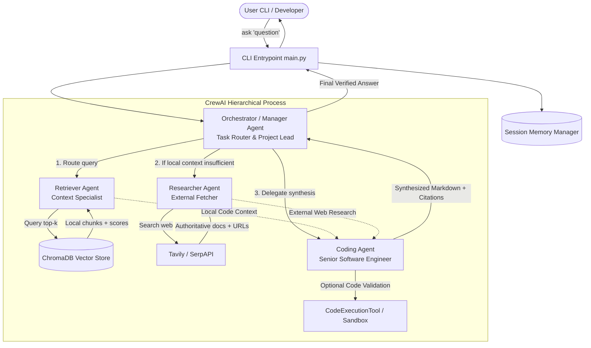

# 🤖 Agentic RAG Coder: Personalized AI Coding Agent with CrewAI

A production-grade, multi-agent AI coding assistant built on **CrewAI** that ingests and indexes your local codebases, documentation, and technical notes into a persistent **ChromaDB** vector store, combines local retrieval-augmented generation (RAG) with external web search fallback, and coordinates senior engineering tasks through a **hierarchical multi-agent crew**.

---

## 🏗️ Architecture & Multi-Agent Flow



---

## 👥 Multi-Agent Roles & Capabilities

| Agent | Role | Goal | Tools |
| :--- | :--- | :--- | :--- |
| **Indexer Agent** | Local Knowledge Curator | Recursively scans folders, computes SHA-256 hashes, chunks code/docs, and upserts into ChromaDB. | `DirectoryLoaderTool`, `TextSplitterTool`, `VectorStoreWriteTool` |
| **Retriever Agent** | Context Retrieval Specialist | Queries ChromaDB for top-$k$ semantically relevant chunks with similarity threshold filtering. | `VectorStoreQueryTool` |
| **Researcher Agent** | External Knowledge Fetcher | Queries external search APIs (Tavily/SerpAPI) when local knowledge is absent or requires modern API specs. | `WebSearchTool` |
| **Coding Agent** | Senior Software Engineer | Writes, debugs, and explains code grounded in gathered context with strict file/URL citations. | `CodeExecutionTool`, `FileWriteTool` |
| **Orchestrator / Manager Agent** | Task Router & Lead | Evaluates user prompts, decides retrieval vs. search strategy, delegates to sub-agents, and verifies output. | Hierarchical Crew Delegation |

---

## 📂 Project Structure

```
agentic-rag-coder/
├── .env.example              # Environment variables template
├── .env                      # Active environment configuration
├── requirements.txt          # Python dependencies
├── README.md                 # System documentation & usage guide
├── config/
│   ├── settings.yaml         # Model names, chunk size, top_k, supported extensions
│   ├── agents.yaml           # Agent roles, goals, and backstories
│   └── tasks.yaml            # Task specifications and expected outputs
├── src/
│   ├── main.py               # Rich/Typer CLI application entrypoint
│   ├── ingestion/
│   │   ├── loader.py         # Multi-format local file loader & incremental hash checking
│   │   ├── chunker.py        # Semantic text and code recursive chunker
│   │   └── vector_store.py   # ChromaDB persistent client, batch upsert, similarity query
│   ├── tools/
│   │   ├── vector_query_tool.py  # CrewAI tool for querying ChromaDB
│   │   ├── web_search_tool.py    # CrewAI tool for Tavily / SerpAPI search
│   │   └── code_exec_tool.py     # CrewAI tool for sandbox code execution & file writing
│   ├── agents/
│   │   └── crew_definitions.py   # Agent factory, task definitions, and hierarchical Crew setup
│   └── memory/
│       └── memory_manager.py     # Multi-turn session memory and history persistence
├── data/
│   ├── raw/                  # Local user codebases, notes, and documentation (.py, .md, .pdf, etc.)
│   ├── chroma_db/            # Persisted ChromaDB vector database and file hash manifest
│   └── memory/               # Persisted multi-turn session conversations
└── tests/
    ├── test_ingestion.py     # Standalone test for loader -> chunker -> Chroma pipeline
    ├── test_retriever.py     # Isolated test for VectorStoreQueryTool
    └── test_researcher.py    # Isolated test for WebSearchTool guardrails and queries
```

---

## 🚀 Quickstart Guide

### 1. Prerequisites
- Python 3.10+ (Tested on Python 3.11, 3.12, 3.13)
- An API key for an LLM provider:
  - **Groq** (Recommended for ultra-fast inference: `llama-3.3-70b-versatile`)
  - **OpenAI** (`gpt-4o-mini`, `gpt-4o`)
  - **Anthropic** (`claude-3-5-sonnet-20241022`)
- Optional: **Tavily** or **SerpAPI** for external web search

### 2. Virtual Environment Setup & Installation
```powershell
# Create virtual environment
python -m venv .venv

# Activate environment
# On Windows:
.venv\Scripts\Activate.ps1
# On Linux/macOS:
source .venv/bin/activate

# Install dependencies using uv or pip
pip install -r requirements.txt
```

### 3. Configure `.env`
Copy the example file:
```powershell
cp .env.example .env
```
Edit `.env` with your API keys:
```env
# Groq (Blazing fast inference)
GROQ_API_KEY=gsk_your_key_here
GROQ_MODEL_NAME=groq/llama-3.3-70b-versatile

# Active Provider: "groq", "openai", or "anthropic"
DEFAULT_LLM_PROVIDER=groq

# Optional Search API
TAVILY_API_KEY=tvly-your_key_here

# Embedding: "chroma_default" (local ONNX MiniLM, free, no key needed)
EMBEDDING_PROVIDER=chroma_default
EMBEDDING_MODEL=all-MiniLM-L6-v2
```

---

## 🌐 Web Interface (Interactive Dashboard)

A modern, responsive web application is included out of the box with zero external npm dependencies.

### Launch the Web Server
```powershell
python src/web_server.py 8000
```
Open **[http://127.0.0.1:8000](http://127.0.0.1:8000)** in your browser.

### Key Web Features
- **💬 Agentic Chat**: Real-time collaborative chat showing animated agent reasoning steps (Manager ➔ Retriever ➔ Researcher ➔ Senior Coder) and grounded responses with code blocks and source badges.
- **📁 Knowledge Base & Ingestion**: Visual file manager displaying indexed files, file sizes, and SHA-256 hash status. Supports one-click incremental sync, collection resets, and quick document uploads.
- **🔍 Vector Search Explorer**: Test semantic retrieval with live similarity threshold sliders and top-$k$ controls to inspect cosine matching percentages.
- **🧠 Crew Agents & Memory**: View agent roles, goals, and active tool configurations, alongside persistent multi-turn session memory history.

---

## 🛠️ CLI Usage Commands

### 1. Ingest & Index Local Files
Recursively scan and incrementally index documents in `./data/raw` (or any custom directory):
```powershell
# Index default directory (./data/raw)
python src/main.py index

# Index a specific project directory with custom chunk size
python src/main.py index --path ./my-project --chunk-size 600 --overlap 80

# Wipe existing collection and re-index from scratch
python src/main.py index --reset
```

#### ⚡ Incremental Indexing Guarantee:
The system computes a **SHA-256 hash** for every file. If you re-run `index`, unchanged files are skipped instantly, and only new or modified files are processed and upserted.

---

### 2. Ask Coding Questions Grounded in Knowledge Base
Ask questions through the hierarchical Crew:
```powershell
# Ask a question grounded in your indexed files
python src/main.py ask "How does our authentication service verify JWT tokens?"

# Override LLM provider on the fly
python src/main.py ask "Explain our error handling architecture" --provider groq

# Disable multi-turn memory for a fresh query
python src/main.py ask "Write a unit test for AuthService" --no-memory
```

---

### 3. Check System & Vector Store Stats
```powershell
python src/main.py stats
```
Displays:
- Vector store collection name
- Total number of indexed chunks
- Persist directory path
- Embedding provider in use
- Active LLM provider

---

### 4. Review Session Memory & Conversation History
```powershell
# View recent conversation turns
python src/main.py history

# Clear session memory
python src/main.py clear-memory
```

---

## 🧪 Testing in Isolation

Run the standalone verification test suites:

```powershell
# 1. Test Ingestion Pipeline (Loader -> Chunker -> ChromaDB -> Incremental Hashing)
python tests/test_ingestion.py

# 2. Test Retriever Tool in Isolation
python tests/test_retriever.py

# 3. Test Web Search Tool & Guardrails in Isolation
python tests/test_researcher.py
```

---

## 🛡️ Guardrails & Hallucination Defense

1. **Local Context Verification**: The `VectorStoreQueryTool` evaluates cosine distance and applies a `similarity_threshold` (default: 0.65). If no local chunk meets this threshold, it explicitly emits `STATUS: NO_LOCAL_CONTEXT_FOUND`.
2. **Missing Search Key Protection**: If neither `TAVILY_API_KEY` nor `SERPAPI_API_KEY` is set, the `WebSearchTool` returns an explicit disclaimer instead of failing silently.
3. **Mandatory Citations**: The Coding Agent is prompted to provide a dedicated **"Sources & Citations"** section listing exact file paths or web URLs. If context is missing from both local and external sources, the agent states what is missing rather than guessing.
